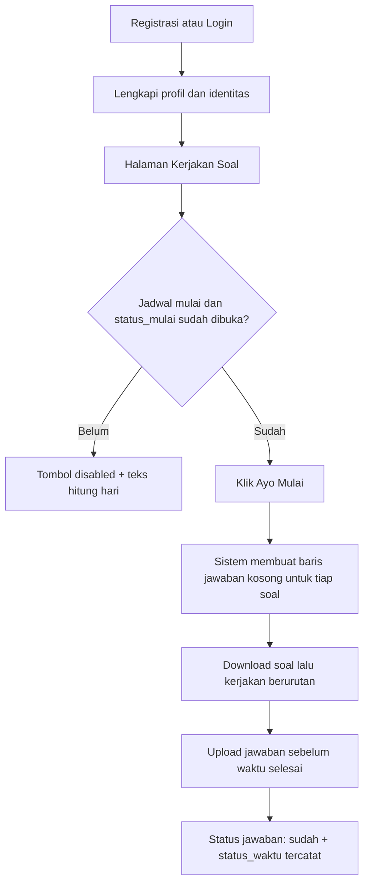
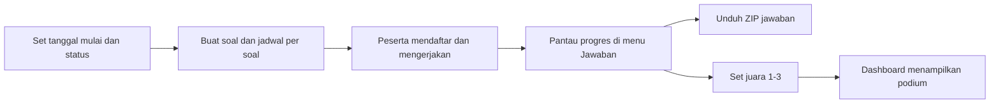
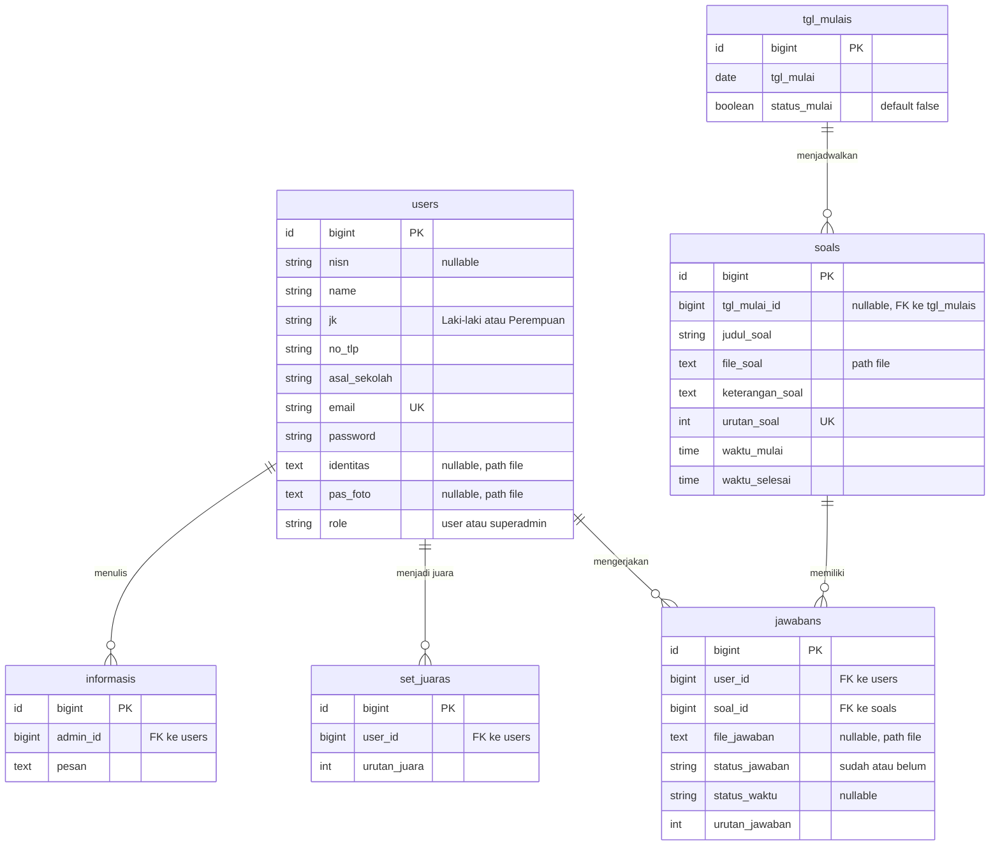

# O.A.S — Aplikasi Lomba (Office Application Skill Competition)

Aplikasi web berbasis **Laravel 11** untuk menyelenggarakan lomba ketrampilan aplikasi perkantoran
(Word/Excel/PowerPoint) secara daring. Peserta mendaftar, mengerjakan soal yang dibuka sesuai jadwal,
lalu mengunggah jawaban sebelum batas waktu. Panitia (superadmin) mengelola peserta, soal, jadwal,
informasi, penentuan juara, serta mengunduh seluruh jawaban peserta.

Nama folder proyek dan beberapa aset masih memakai istilah **LCC** (contoh: `logo_lcc.png`), sementara
identitas aplikasi yang dipakai saat ini adalah **O.A.S** (`APP_NAME`).

---

## Daftar Isi

- [Fitur Utama](#fitur-utama)
- [Peran Pengguna](#peran-pengguna)
- [Alur Kerja Peserta](#alur-kerja-peserta)
- [Alur Kerja Admin](#alur-kerja-admin)
- [Teknologi](#teknologi)
- [Struktur Database](#struktur-database)
- [Rute Aplikasi](#rute-aplikasi)
- [Struktur Direktori Penting](#struktur-direktori-penting)
- [Instalasi](#instalasi)
- [Catatan & Keterbatasan](#catatan--keterbatasan)

---

## Fitur Utama

| Fitur                     | Keterangan                                                                                                 |
| ------------------------- | ---------------------------------------------------------------------------------------------------------- |
| Autentikasi               | Login/registrasi mandiri (`laravel/ui`), ubah password dari navbar, rute reset password via email tersedia |
| Countdown pembukaan lomba | Berdasarkan `tgl_mulais.tgl_mulai` dan flag `status_mulai`                                                 |
| Countdown per soal        | Dihitung di sisi klien dari `waktu_mulai`–`waktu_selesai` tiap soal, berjalan tiap detik (informatif)      |
| Upload jawaban            | Per soal, maksimal 5 MB, nama file otomatis `nama_peserta_judul_soal.ext`                                  |
| Deteksi ketepatan waktu   | Menyimpan selisih menit ("x menit lebih cepat" / "x menit terlambat" / "Tepat waktu")                      |
| Unduh jawaban massal      | Superadmin mengunduh semua jawaban satu peserta dalam bentuk ZIP                                           |
| Papan juara               | Podium juara 1–3 tampil di dashboard setelah di-set admin                                                  |
| Informasi/notifikasi      | Pengumuman admin muncul di dashboard dan dropdown lonceng di navbar                                        |
| Profil peserta            | Foto profil, unggah kartu identitas, data diri, reset password                                             |

---

## Peran Pengguna

Role disimpan pada kolom `users.role` dengan nilai `user` atau `superadmin`, dan dipetakan menjadi
**Gate** `user` / `superadmin` di `app/Providers/AppServiceProvider.php`. Pembatasan rute dilakukan oleh
`App\Http\Middleware\RoleMiddleware`.

### Peserta (`user`)

- Registrasi mandiri (nama, jenis kelamin, no. telepon, asal sekolah, email, password).
- Melengkapi profil: NISN, kartu identitas (gambar ≤ 3 MB), foto profil.
- Melihat dashboard: banner, daftar informasi terbaru, dan podium juara.
- Membuka halaman **Kerjakan Soal** setelah jadwal dimulai.
- Mengunduh file soal dan mengunggah jawaban per soal.
- Melihat kembali jawaban yang sudah diunggah.

### Superadmin (`superadmin`)

- **Peserta** — daftar peserta (filter jenis kelamin, pencarian nama/sekolah/email), tambah, hapus,
  reset password.
- **Buat Soal** — CRUD soal (urutan unik, judul, file soal, keterangan, jam mulai & selesai) serta
  pengaturan tanggal mulai lomba.
- **Jawaban** — rekap progres jawaban tiap peserta, unduh ZIP per peserta, dan reset seluruh jawaban.
- **Set Juara** — menetapkan juara 1–3 (maksimal 3 baris, urutan dan peserta unik).
- **Informasi** — CRUD pengumuman yang tampil ke seluruh pengguna.

---

## Alur Kerja Peserta



Detail teknis:

1. `GET /soal` menghitung `daysLeft` dari `tgl_mulais` terbaru dan menonaktifkan tombol bila
   `now < tgl_mulai` atau `status_mulai` masih `false`.
2. `POST /kerjakan` membuat satu record `jawabans` (status `belum`) untuk **setiap** soal yang ada,
   menyalin `urutan_soal` menjadi `urutan_jawaban`.
3. Tombol _Download Soal_ dan _Upload Jawaban_ pada tiap kartu di-render `disabled` dan baru diaktifkan oleh
   JavaScript bila soal **sebelumnya** berstatus `sudah` (soal pertama dianggap selalu terbuka). Countdown
   per soal hanya bersifat informatif — versi skrip yang mengunci tombol berdasarkan jam dikomentari di
   `resources/views/soal/index.blade.php`.
4. `POST /upload/{jawabanId}` menyimpan file ke disk `public` folder `jawaban`, menghitung selisih menit
   terhadap `waktu_selesai`, lalu mengubah status menjadi `sudah`.

---

## Alur Kerja Admin



- Tanggal mulai disimpan pada `tgl_mulais`; `status_mulai` adalah saklar manual untuk membuka lomba.
- Menu **Jawaban** menampilkan jam selesai dan status berdasarkan jawaban dengan `urutan_jawaban = 3`
  (dianggap soal terakhir).
- **Reset Jawaban** menghapus file di storage dan mengosongkan tabel `jawabans` (`truncate`), sehingga
  seluruh peserta harus mengerjakan ulang.

---

## Teknologi

| Komponen         | Versi / Keterangan                                                     |
| ---------------- | ---------------------------------------------------------------------- |
| PHP              | `^8.2`                                                                 |
| Framework        | Laravel `^11.9`                                                        |
| Auth scaffolding | `laravel/ui ^4.5`                                                      |
| Database         | MySQL (`DB_CONNECTION=mysql`, default config Laravel: `sqlite`)        |
| Frontend         | Blade + Bootstrap 5 (asset statis di `public/assets`), ikon Feather    |
| Interaksi        | jQuery, SweetAlert2, countdown JavaScript murni (tanpa build step)     |
| Build tool       | Vite (tersedia, namun tampilan saat ini memakai asset statis langsung) |
| Arsip            | `ZipArchive` (ekstensi PHP `zip`) untuk unduh jawaban                  |

> Catatan: `@vite` tidak dipakai di layout. Semua CSS/JS dimuat dari `public/assets`, `public/welcome`,
> dan `public/loginregister`, serta beberapa CDN.

---

## Struktur Database



Relasi Eloquent yang tersedia:

- `User::jawaban()` — hasMany `Jawaban`
- `Jawaban::soal()` — belongsTo `Soal`
- `SetJuara::peserta()` — belongsTo `User`
- `Soal` dan `TglMulai` belum memiliki relasi Eloquent (relasi `tanggal()` dikomentari), sehingga view
  memakai `$datatgl->tgl_mulai` dari query terpisah.

---

## Rute Aplikasi

| Method   | URI                             | Handler                                  | Akses        |
| -------- | ------------------------------- | ---------------------------------------- | ------------ |
| GET      | `/`                             | Closure → `welcome`                      | Publik       |
| —        | `auth` routes                   | `Auth::routes()`                         | Publik/guest |
| GET      | `/home`                         | `HomeController@index`                   | Login        |
| GET      | `/profile`                      | `HomeController@profile`                 | Login        |
| POST     | `/identitas`                    | `HomeController@upload_identitas`        | Login        |
| POST     | `/profile`                      | `HomeController@upload_profile`          | Login        |
| POST     | `/update_profile`               | `HomeController@update_profile`          | Login        |
| DELETE   | `/delete_profile`               | `HomeController@delete_profile`          | Login        |
| POST     | `/password_reset`               | `HomeController@password_reset`          | Login        |
| GET      | `/soal`                         | `KerjakanSoalController@index`           | `user`       |
| POST     | `/kerjakan`                     | `KerjakanSoalController@mengerjakan`     | `user`       |
| POST     | `/upload/{jawabanId}`           | `KerjakanSoalController@uploadJawaban`   | `user`       |
| resource | `/peserta`                      | `PesertaController`                      | `superadmin` |
| PUT      | `/resetpassword/{id}`           | `PesertaController@reset_password`       | `superadmin` |
| resource | `/create-soal`                  | `CreateSoalController`                   | `superadmin` |
| POST     | `/tgl_mulai`, `/tgl_mulai/{id}` | `TglMulaiCoontroller`                    | `superadmin` |
| GET      | `/jawaban`                      | `JawabanController@index`                | `superadmin` |
| GET      | `/download-jawaban/{userId}`    | `JawabanController@download_jawaban_zip` | `superadmin` |
| POST     | `/jawaban/reset`                | `JawabanController@resetJawaban`         | `superadmin` |
| resource | `/set_juara`                    | `SetJuaraController`                     | `superadmin` |
| resource | `/informasi`                    | `InformasiController`                    | `superadmin` |

Catatan rute:

- `Route::resource` mendaftarkan `create/show/edit` juga, tetapi method tersebut kosong di controller —
  aksi dilakukan lewat modal pada halaman `index`.
- `/tgl_mulai` dan `/tgl_mulai/{id}` memakai `POST` (bukan `PUT`) untuk update.
- `Auth::routes()` menyediakan `/login`, `/register`, `/password/reset`, `/password/email`, dan
  `/password/confirm`.

---

## Struktur Direktori Penting

```
app/
├── Http/
│   ├── Controllers/
│   │   ├── Auth/                  # Login, Register, Reset/Confirm password (laravel/ui)
│   │   ├── CreateSoalController   # CRUD soal + file soal
│   │   ├── HomeController         # Dashboard, profil, identitas, ubah password
│   │   ├── InformasiController    # CRUD pengumuman
│   │   ├── JawabanController      # Rekap jawaban, unduh ZIP, reset
│   │   ├── KerjakanSoalController # Countdown, mulai ujian, upload jawaban
│   │   ├── PesertaController      # Manajemen peserta
│   │   ├── SetJuaraController     # Penentuan juara
│   │   └── TglMulaiCoontroller    # Jadwal mulai lomba
│   └── Middleware/RoleMiddleware.php
├── Models/                        # User, Soal, Jawaban, TglMulai, SetJuara, Informasi
└── Providers/AppServiceProvider   # Gate user/superadmin, view composer informasi, paginator

database/
├── migrations/                    # users, cache, jobs, informasis, set_juaras, tgl_mulais, soals, jawabans
└── seeders/DatabaseSeeder.php     # 2 akun superadmin awal

resources/views/
├── layouts/{app,sidebar,navbar}.blade.php   # kerangka.blade.php ada tapi tidak dipakai
├── dashboard/  soal/  peserta/  createsoal/  jawaban/  set_juara/  informasi/  profile/
└── auth/  paginator/  welcome.blade.php

public/
├── assets/        # CSS/JS tema (style.css, pcoded, bootstrap, feather) + gambar
├── storage/       # symlink ke storage/app/public (soal, jawaban, profile, identitas)
├── loginregister/ # template halaman login & register
└── welcome/       # CSS halaman landing
```

---

## Instalasi

Prasyarat: PHP ≥ 8.2 dengan ekstensi `zip`, Composer, Node.js (opsional), MySQL.

```bash
# 1. Dependensi
composer install
npm install

# 2. Konfigurasi environment
cp .env.example .env
php artisan key:generate
# sesuaikan DB_CONNECTION=mysql, DB_DATABASE, DB_USERNAME, DB_PASSWORD

# 3. Migrasi + data admin awal
php artisan migrate --seed

# 4. Symlink storage (wajib: file soal/jawaban disajikan dari /storage)
php artisan storage:link

# 5. Jalankan
php artisan serve
```

Aset frontend saat ini sudah tersedia sebagai file statis di `public/assets`, jadi `npm run build`
tidak diperlukan kecuali Anda mengubah sumber di `resources/`.

Akun superadmin dari seeder:

| Email                      | Password       |
| -------------------------- | -------------- |
| `superadmin@gmail.com`     | `password#123` |
| `emailpakaripin@gmail.com` | `password`     |

> Segera ganti kredensial ini sebelum dipakai di lingkungan nyata. Konfigurasi `MAIL_MAILER=log`
> berarti email reset password hanya ditulis ke `storage/logs/laravel.log`, bukan dikirim.

---

## Catatan & Keterbatasan

Hal-hal berikut ditemukan saat meninjau kode dan sebaiknya diperhatikan bila aplikasi dikembangkan:

1. **Batas waktu tidak ditegakkan.** Skrip yang mengunci tombol berdasarkan jam dikomentari, sehingga
   tombol hanya bergantung pada status soal sebelumnya. Server pun (`uploadJawaban()`) tidak menolak
   unggahan di luar `waktu_mulai`–`waktu_selesai`.
2. **`user_id` dikirim dari hidden input** pada form `/kerjakan`, bukan diambil dari sesi
   (`Auth::user()->id`), sehingga berpotensi dimanipulasi.
3. **`POST /kerjakan` tidak idempoten.** Menekan tombol dua kali akan menggandakan baris jawaban; belum
   ada `unique(user_id, soal_id)`.
4. **Progres jawaban admin** (`JawabanController@index`) hanya membaca baris dengan `urutan_jawaban = 3`,
   sehingga jumlah soal selain 3 membuat status/jam selesai tidak akurat.
5. **`RoleMiddleware` mengembalikan `back()`** saat akses ditolak; untuk permintaan langsung tanpa
   referer dapat menghasilkan respons kosong. Alternatif `abort(403)` lebih jelas.
6. **`HomeController@upload_profile`** langsung memanggil `store()` tanpa cek `hasFile()`, sehingga error
   bila form dikirim tanpa file.
7. **Podium dashboard** mengakses `$juaraX->peserta->pas_foto` tanpa fallback; peserta tanpa foto profil
   menghasilkan `src` kosong (bukan gambar default seperti di sidebar).
8. **`CreateSoalController@destroy`** hanya menghapus record jika file soal ada di storage.
9. **`tgl_mulais` hanya menyimpan tanggal** (tanpa jam), sehingga hitungan "hari lagi" berbasis selisih
   hari, sementara jam mulai sebenarnya diatur per soal.
10. **Penamaan belum konsisten**: `TglMulaiCoontroller` (salah ketik), istilah LCC vs O.A.S, dan
    `.env` memakai MySQL sedangkan `database/database.sqlite` juga tersedia.
11. **Tidak ada test fungsional** — `tests/` hanya berisi contoh bawaan Laravel.
12. **`layouts/kerangka.blade.php`** tidak direferensikan oleh view mana pun (sisa template lama).
13. **Error bila belum ada jadwal.** `KerjakanSoalController@index` mengembalikan view hanya dengan
    `daysLeft` dan `isDisabled` ketika `tgl_mulais` kosong, padahal view juga memakai `$cekjawaban`,
    `$jawaban`, dan `$countdown` → _undefined variable_.
14. **Urutan soal hanya dijaga di klien.** Server tidak memeriksa apakah soal sebelumnya sudah dijawab,
    sehingga `POST /upload/{jawabanId}` bisa dipanggil langsung tanpa mengikuti urutan.
15. **Perbandingan `$juara1 == !null`** pada dashboard bergantung pada konversi truthy objek; lebih aman
    memakai `@if ($juara1 && $juara2 && $juara3)`.
